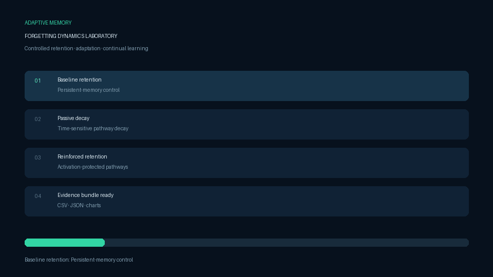
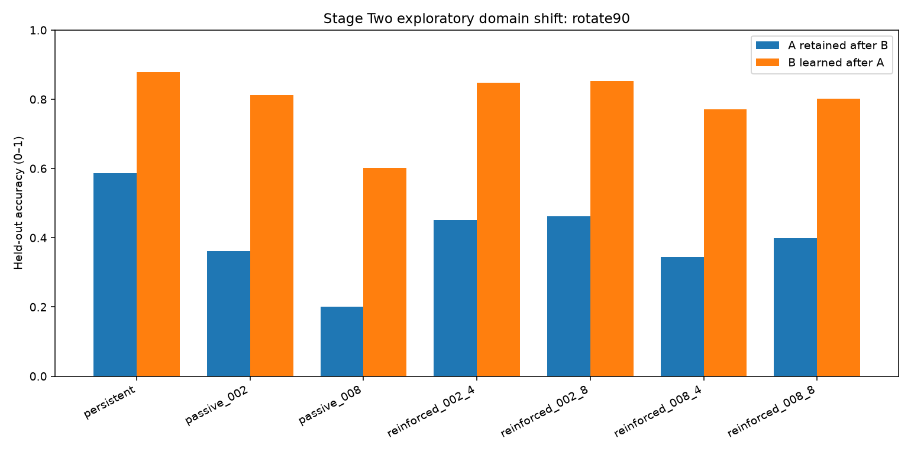
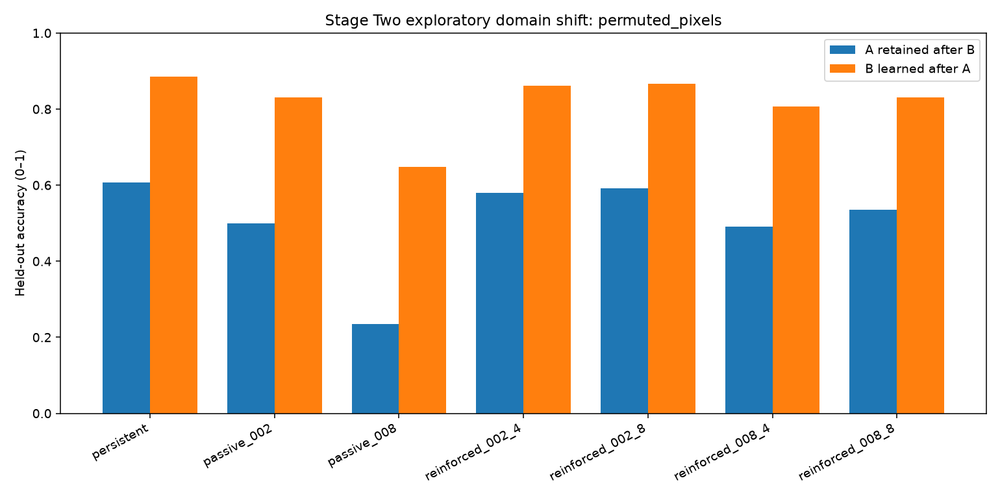

# Adaptive Memory Dynamics

**Can machine-learning systems benefit from forgetting selectively instead of retaining every pathway equally?**

Adaptive Memory Dynamics is a reproducible research framework for temporal decay, reinforcement-sensitive retention, and continual learning. It turns the capstone proposal *Human-Like Forgetting Dynamics in Machine Learning Systems* into an executable Stage One laboratory.



[Methods](docs/METHODS.md) · [Evidence guide](docs/EVIDENCE.md) · [Architecture](docs/ARCHITECTURE.md) · [Roadmap](docs/ROADMAP.md) · [Data catalog](data/README.md) · [Baseline results](data/stage_one_baseline/runs/2026-09-15_digits-8x8-v1/) · [Research library](docs/research/README.md)

## What is implemented

| Mechanism | Operational definition | Experimental purpose |
|---|---|---|
| Persistent baseline | Standard gradient updates; no post-update decay | Control condition |
| Passive temporal decay | All hidden pathways decay as inactivity accumulates | Tests whether indiscriminate forgetting helps |
| Reinforced retention | Frequently activated pathways receive lower effective decay | Tests selective, use-dependent memory |

The current protocol measures:

- supervised train/test accuracy and generalization gap;
- accuracy after a controlled idle-decay interval;
- Task A retention after learning disjoint Task B;
- Task B adaptation speed;
- pathway usage and model-weight dynamics;
- variance across independent random seeds.

## Run the experiment

```bash
python -m venv .venv
source .venv/bin/activate  # Windows: .venv\Scripts\activate
pip install -e ".[dev]"
python -m adaptive_memory.cli
```

Every run creates an immutable evidence bundle under `results/runs/<timestamp>/`:

```text
manifest.json              environment, protocol, and claim boundary
raw_metrics.csv            epoch-level observations
run_summary.csv            one row per mechanism and seed
accuracy_curves.png         learning progression
mechanism_comparison.png    accuracy and retention comparison
continual_forgetting.png    Task A loss after Task B
```

For a short pipeline check:

```bash
python -m adaptive_memory.cli --quick
```

## One-click research dashboard

```bash
python -m adaptive_memory.gui
```

The dashboard runs the complete mechanism × seed matrix and exports the evidence package with one button. Stop requests finish the current atomic run and safely export completed observations.

## Scientific status

The checked-in Stage One results use scikit-learn's offline 8×8 handwritten-digits dataset to validate the full protocol. They are **exploratory engineering evidence**, not a substitute for the proposal's planned MNIST, Fashion-MNIST, CIFAR-10, and sequential benchmarks. Findings remain hypotheses until replicated at the planned scale with preregistered comparisons and statistical analysis.

This boundary is deliberate: the repository separates implemented mechanisms, measured observations, and future claims.

## Stage Two — Domain-Incremental Retention Research (five-seed exploratory results)

The completed first Stage Two experiment measures whether use-dependent forgetting can improve retention and adaptation when **all ten digit labels stay the same**, but the input representation changes (90° rotations or fixed pixel permutations). It runs **seven paired mechanism/rate conditions** on identical splits, weight initializations and batch schedules, with per-seed metrics, descriptive bootstrap intervals, CSV, reproducibility manifest and plots.

```bash
python -m adaptive_memory.stage_two --pilot --output results/stage-two-pilot
python -m adaptive_memory.stage_two --output results/stage-two
```

**[Read the full Stage Two experimental results](docs/STAGE_TWO_RESULTS.md)** · [Protocol](docs/STAGE_TWO_DOMAIN_SHIFT.md) · [Versioned experimental dataset](data/stage_two_exploratory/runs/2026-10-15_domain-shift-paired-v1/). **This remains exploratory on scikit-learn 8×8 digits**—no claim of MNIST/CIFAR validation, improved continual learning or positive findings has been established. The September Stage One result, in which the persistent baseline retained Task A better than both decay mechanisms, remains unchanged.

### Stage Two results at a glance (five paired seeds)

Across the tested 90-degree rotation and pixel-permutation shifts, the **persistent baseline achieved the highest average Task A retention and Task B accuracy**. Reinforced use-dependent decay generally outperformed comparable passive decay conditions but **did not outperform persistence**. These are exploratory 8×8 scikit-learn digit results, not a general continual-learning benchmark.

| Domain B | Condition | Task A after B | Task B after A |
|---|---|---:|---:|
| 90° rotation | Persistent baseline | **58.7%** | **87.9%** |
| 90° rotation | Reinforced decay (rate 0.002, strength 8) | 46.3% | 85.2% |
| Pixel permutation | Persistent baseline | **60.7%** | **88.5%** |
| Pixel permutation | Reinforced decay (rate 0.002, strength 8) | 59.1% | 86.6% |





The [complete report](docs/STAGE_TWO_RESULTS.md) includes all seven conditions, variation across seeds and descriptive paired bootstrap intervals. The [data catalog](data/README.md) links raw CSVs and the SHA-256 manifest. **We should not claim statistically confirmed superiority or report a positive outcome without a stronger independent study.**

## Research documents

- [Stage One Technical Report](docs/research/stage-one-technical-report.pdf) — frozen five-seed evidence and limitations
- [Pre-Registered Experimental Protocol](docs/research/experimental-protocol.pdf) — next parameter and mechanism ablation
- [Tier 1: Capstone Research Concept](docs/research/tier-1-capstone.pdf) — controlled forgetting and adaptive retention
- [Tier 2: Master's Research Design](docs/research/tier-2-masters.pdf) — continual-learning extensions and ablations
- [Tier 3: Doctoral Research Agenda](docs/research/tier-3-doctoral-agenda.pdf) — formal, scalable, resource-constrained memory dynamics

Use the [navigable research library](docs/research/README.md) for reading order, evidence status, and claim boundaries.

## Development

```bash
ruff check .
pytest -q
python -m adaptive_memory.demo
```

CI tests Python 3.10 and 3.12, runs the unit suite, executes a smoke experiment, and uploads its evidence as a workflow artifact.

## Citation and license

See [CITATION.cff](CITATION.cff). Code is released under the [MIT License](LICENSE).
