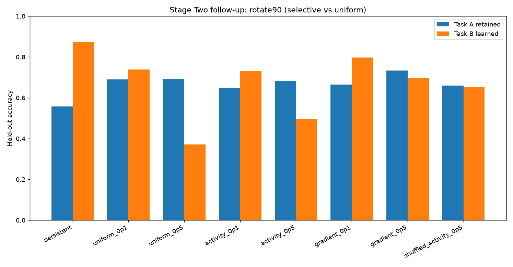
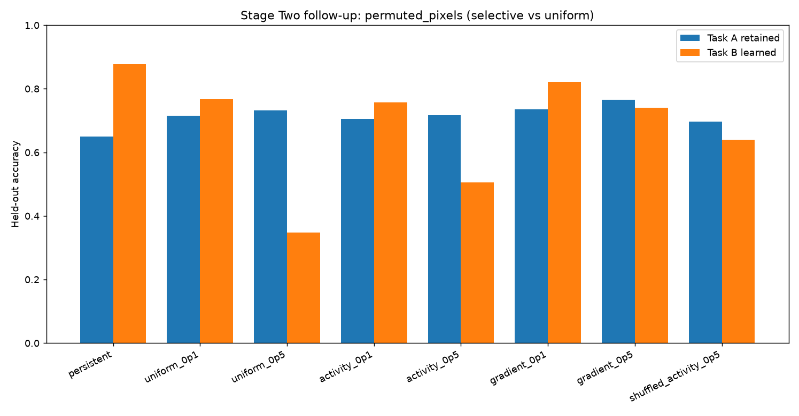

# Adaptive Memory Dynamics — Selective Consolidation Follow-Up

**Exploratory software evidence · October 15, 2026 · not peer reviewed**

[Repository](../README.md) · [Previous Stage Two findings](STAGE_TWO_RESULTS.md) · [Full evidence bundle](../data/stage_two_exploratory/runs/2026-10-15_selective-consolidation-v1/)

## Research question

Our original continuous parameter-decay mechanisms did not improve domain-incremental retention: persistent memory was more accurate on Task A and Task B on average. This follow-up tests a different, explicit mechanism: **consolidate Task A, then protect selected parameters from Task B updates**. Does selective protection improve the **stability/plasticity trade-off** relative to *uniform* protection and no protection?

The original Stage One and earlier Stage Two records are unchanged.

## Implementation and controls

The data remain offline **scikit-learn 8×8 handwritten digits**, ten shared labels, and two synthetic Task B transformations: 90° rotation and seeded pixel permutation. No MNIST/CIFAR or human-memory claims. Five **new** paired seeds (1109, 1201, 1301, 1409, 1501) each share the same Task A checkpoint, A/B train/test split, and Task B minibatch order across eight configurations:

- Persistent: no anchoring.
- Uniform quadratic weight anchoring (penalties 0.1 and 0.5).
- Activity-weighted pathway anchoring (penalties 0.1 and 0.5).
- Squared *minibatch-gradient proxy* anchoring (penalties 0.1 and 0.5; **not an empirical Fisher/EWC benchmark**).
- Shuffled-activity importance (0.5): negative control testing whether pathway ranking matters.

All methods receive eight Task A epochs and eight Task B epochs, a 32-unit ReLU hidden layer and SGD at 0.08. Importance comes from Task A **training** samples only. This post-SGD quadratic step is a software prototype, not exact joint-loss optimization.

## Observed held-out outcomes

All values are mean proportions over **five paired seeds**; percent equivalents are included for readability. **Higher Task A after B** means better old-task retention; **higher Task B** means better current-task adaptation.

| Treatment | Rotation A | Rotation B | Permutation A | Permutation B |
|---|---:|---:|---:|---:|
| Persistent | 55.73% | **87.24%** | 64.93% | **87.82%** |
| Uniform 0.1 | 69.02% | 73.82% | 71.47% | 76.67% |
| Uniform 0.5 | 69.24% | 37.16% | 73.20% | 34.76% |
| Activity 0.1 | 64.89% | 73.24% | 70.58% | 75.78% |
| Activity 0.5 | 68.13% | 49.73% | 71.64% | 50.49% |
| Gradient proxy 0.1 | 66.49% | 79.69% | 73.51% | 82.09% |
| Gradient proxy 0.5 | **73.42%** | 69.73% | **76.62%** | 74.04% |
| Shuffled activity 0.5 | 65.91% | 65.29% | 69.73% | 64.04% |

The gradient-proxy 0.1 condition has the highest **mean of Task A and B accuracy** of the regularized alternatives (approximately 73.09% for rotated, 77.80% for permuted); persistent remains slightly higher in those unweighted mean scores (71.49% for rotated, 76.38% for permuted)—**correction:** gradient proxy 0.1 exceeds persistent on this specific balanced metric, despite lower B accuracy. More specifically, its balanced means are **73.09% and 77.80%**, compared with **71.49% and 76.38%** for persistent. This is an exploratory trade-off, not independently validated superiority.

**Key contrast:** keeping Task A accuracy is possible without decay during training. More protection can reduce learning of B substantially. Gradient importance outperformed activity importance at the same penalty in this dataset; at strong penalty, shuffled importance also differs from the unshuffled mask, but neither wins both tasks.





## Statistical interpretation

The linked `paired_effects.csv` contains 5-seed paired mean differences from persistent with descriptive 95% bootstrap intervals, unadjusted for the **many** treatments, endpoints, and two domains. This experiment is exploratory and its hyperparameters were designed after inspecting the original Stage Two results. Do **not** claim inferential statistical significance, generalized continual-learning superiority or a validated biological theory of selective forgetting. A future confirmatory study must predeclare one primary stability/plasticity metric, use a fresh held-out set of seeds, and compare strong standard baselines (such as replay and correctly implemented EWC).

## Reproducibility

[Archived manifest](../data/stage_two_exploratory/runs/2026-10-15_selective-consolidation-v1/manifest.json) records software environment, source commit, seeds, treatments, and SHA-256 CSV digests. **80 independent condition runs** (5 seeds × 2 domains × 8 conditions), **1,280 epoch-level observations**, and **42 paired effect records** were generated by [the successful CI run](https://github.com/Tybent18/adaptive-memory-dynamics/actions/runs/38830172954).

```bash
pip install -e ".[dev]"
ruff check .
pytest -q
python -m adaptive_memory.selection_followup --output results/selection-followup
```

The previous experiments and their research documents remain available without edits. This follow-up does not supersede the old negative results—it offers a different, testable explanation and direction.
